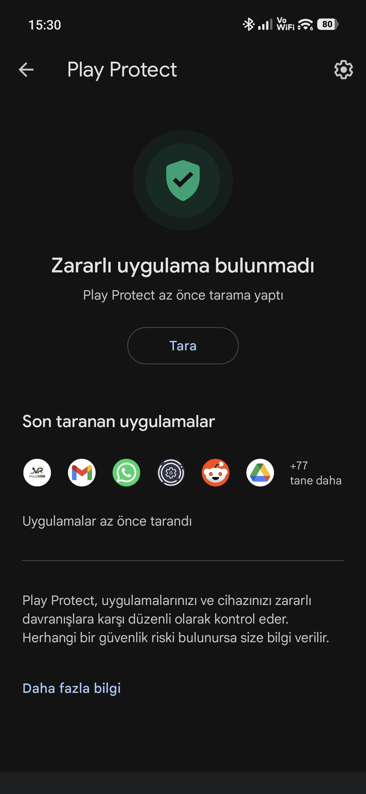

# PocoVRR — Poco X8 Pro Max / HyperOS 3 VRR Engine

[](https://github.com/zewzack)
[](https://github.com/zewzack/PocoVRR)

[Português (BR)](README.pt-BR.md) · [Türkçe](README.tr.md)

PocoVRR is a smart, optimized **Refresh Rate (VRR) Controller** built specifically for the Poco X8 Pro Max (LTPS panel) and HyperOS devices.

## 🚀 Key Features

- **Smart switching:** 120 Hz the moment your finger touches the screen; after the idle timeout you configure (1s–3s), it drops to the minimum Hz (60, 90, 120).
- **Powerkeeper protection:** a **Guard Loop** and **ContentObserver** mechanism that stops system services (Powerkeeper) from lowering the refresh rate.
- **Full-screen experience:** a fully black, edge-to-edge modern interface.
- **Low latency:** touch and scroll events captured instantly through accessibility services.

---

## 🛠️ Setup Guide (IMPORTANT)

The app needs permission to change system settings in order to work. This permission can only be granted once, from a computer.

### 🛡️ Why does it need so many permissions?

<details>
<summary><b>Detailed security &amp; transparency note (click to expand)</b></summary>

The history of the Android ecosystem includes malware and vulnerabilities that put end users at risk, especially on older devices. As a result, users with limited technical knowledge — or who are far from the Android ecosystem — ended up regarding Android devices as "unsafe".

Google's current Android app and version policies require the end user's explicit, informed consent even for the smallest actions that could affect how the device behaves or is organized. This multi-step flow (ADB commands, accessibility confirmations, etc.) is meant to keep user safety as high as possible. We developers know these steps sometimes make the experience harder; but they are part of the system's modern protection mechanisms.

</details>

### Step 1: Prepare the phone
1. Go to **Settings > About phone** and tap **OS version** (or MIUI version) 7 times to enable **Developer options**.
2. Go to **Additional settings > Developer options**.
3. Enable all three options:
   - **USB debugging**
   - **USB debugging (Security settings)** *(critical on MIUI/HyperOS)*
   - **Install via USB**

### Step 2: Getting past the Play Protect warning
To do its job, PocoVRR requests system-level permissions such as `WRITE_SECURE_SETTINGS` and the Accessibility Service. Because of these, Google Play Protect may flag the app as coming from an "Unknown publisher" and show a warning — or block the install.

**🛡️ Getting past the Play Protect warning:**
1. Open the Play Store and tap your profile icon in the top right.
2. Go to **Play Protect > Settings (gear icon)**.
3. Temporarily turn off **"Scan apps with Play Protect"**.
4. Install the PocoVRR APK. You can turn the setting back on once the install finishes.

This warning is entirely due to the system permissions the app requests and poses no security risk to your device. The app is fully **open source**, can be inspected transparently, and is released under the **MIT License**.



### Step 3: Authorize from your computer (ADB)
1. Download the [Android Platform Tools (ADB)](https://developer.android.com/tools/releases/platform-tools) package on your computer and extract it to a folder.
2. Connect the phone to the computer with a USB cable. Select "File transfer" mode on the phone and tap **"Always allow"** on the "USB debugging" authorization dialog.
3. Inside the ADB folder (where `adb.exe` lives), **Shift + Right-click** an empty area and choose "Open PowerShell window here" or "Open terminal".
4. Paste this command into the terminal and press Enter:

```bash
./adb shell pm grant com.zewzack.pocovrr android.permission.WRITE_SECURE_SETTINGS
```

### Step 4: In-app permissions
After the computer step is done, grant these permissions inside the app, in order:
- **Allow restricted settings:** the accessibility permission cannot be granted until this is enabled in the app's settings.
- **Accessibility service:** enable PocoVRR under "Downloaded apps".
- **Autostart:** allow it so the system doesn't kill the app.
- **Battery restriction:** set the battery saver option to **"No restrictions"**.

---

## ⚙️ App Settings

- **Minimum Hz:** 30 (experimental), 60, 90, 120. (battery vs. smoothness trade-off)
- **Maximum Hz:** 60, 90, 120. (the speed while you're interacting)
- **Idle delay:** how many seconds of inactivity before the Hz drops (1s, 2s, 3s).

---

## 🖥️ Technical Details

PocoVRR controls HyperOS's proprietary secure settings keys:
- `miui_refresh_rate`
- `user_refresh_rate`

During transitions or system interventions, a **Guard** mechanism checks the value every 100 ms for 500 ms and keeps it pinned at the target value.

---

## 👨‍💻 Developer
**@zewzack**

---

*This project is shared as open source. It does not cause any battery or screen-on time problems; on the contrary, it helps battery life by lowering the Hz on static images.*
