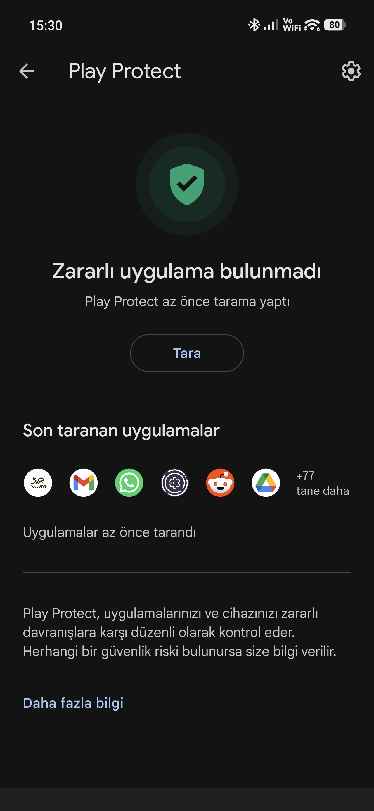

# PocoVRR — Motor VRR do Poco X8 Pro Max / HyperOS 3

[](https://github.com/zewzack)
[](https://github.com/zewzack/PocoVRR)

[English](README.md) · **Português (BR)** · [Türkçe](README.tr.md)

PocoVRR é um **Controlador de Taxa de Atualização (VRR)** inteligente e otimizado, desenvolvido especificamente para o Poco X8 Pro Max (painel LTPS) e aparelhos com HyperOS.

## 🚀 Principais recursos

- **Troca inteligente:** 120 Hz no instante em que o dedo toca a tela; após o tempo ocioso que você configurar (1s–3s), o valor cai para o Hz mínimo (60, 90, 120).
- **Proteção do Powerkeeper:** mecanismo **Guard Loop** + **ContentObserver** que impede os serviços do sistema (Powerkeeper) de reduzirem a taxa de atualização.
- **Experiência em tela cheia:** interface moderna, totalmente preta e edge-to-edge.
- **Baixa latência:** eventos de toque e rolagem capturados instantaneamente pelos serviços de acessibilidade.

---

## 🛠️ Guia de Instalação (IMPORTANTE)

Para funcionar, o aplicativo precisa de permissão para alterar configurações do sistema. Essa permissão só pode ser concedida uma vez, pelo computador.

### 🛡️ Por que ele pede tantas permissões?

<details>
<summary><b>Explicação detalhada de segurança e transparência (clique para abrir)</b></summary>

O histórico do ecossistema Android inclui malware e vulnerabilidades que colocaram usuários finais em risco, especialmente em aparelhos mais antigos. Por isso, usuários com pouca experiência técnica — ou distantes do ecossistema Android — passaram a considerar os aparelhos Android como "inseguros".

As políticas atuais de apps e versões do Android exigem o consentimento explícito e informado do usuário final mesmo para as menores ações que possam afetar o funcionamento ou a organização do aparelho. Esse fluxo em várias etapas (comandos ADB, confirmações de acessibilidade etc.) tem o objetivo de manter a segurança do usuário no mais alto nível. Nós, desenvolvedores, sabemos que essas etapas às vezes complicam a experiência; mas elas fazem parte dos mecanismos modernos de proteção do sistema.

</details>

### Etapa 1: Preparar o telefone
1. Vá em **Configurações > Sobre o telefone** e toque 7 vezes em **Versão do sistema** (ou versão do MIUI) para ativar as **Opções do desenvolvedor**.
2. Acesse **Configurações adicionais > Opções do desenvolvedor**.
3. Ative as três opções:
   - **Depuração USB**
   - **Depuração USB (Configurações de segurança)** *(crítico no MIUI/HyperOS)*
   - **Instalar via USB**

### Etapa 2: Passar pelo aviso do Play Protect
Para cumprir sua função, o PocoVRR solicita permissões de nível de sistema, como `WRITE_SECURE_SETTINGS` e o Serviço de Acessibilidade. Por causa disso, o Google Play Protect pode marcar o app como vindo de uma **"Editora desconhecida"**, exibir um aviso — ou bloquear a instalação.

**🛡️ Passando pelo aviso do Play Protect:**
1. Abra a Play Store e toque no ícone do seu perfil (canto superior direito).
2. Vá em **Play Protect > Configurações (ícone de engrenagem)**.
3. Desative temporariamente a opção **"Verificar apps com o Play Protect"**.
4. Instale o APK do PocoVRR. Você pode reativar a opção depois que a instalação terminar.

Este aviso tem tudo a ver com as permissões de sistema que o app solicita e não representa nenhum risco de segurança para o seu aparelho. O app é totalmente **código aberto**, pode ser inspecionado de forma transparente e é licenciado sob a **licença MIT**.



### Etapa 3: Autorizar pelo computador (ADB)
1. Baixe o pacote [Android Platform Tools (ADB)](https://developer.android.com/tools/releases/platform-tools) no seu computador e extraia em uma pasta.
2. Conecte o telefone ao computador com o cabo USB. Selecione o modo **"Transferir arquivos"** no telefone e toque em **"Permitir sempre"** no aviso de "Depuração USB".
3. Dentro da pasta do ADB (onde fica o `adb.exe`), dê **Shift + clique direito** em um espaço vazio e escolha "Abrir janela do PowerShell aqui" ou "Abrir terminal".
4. Cole este comando no terminal e pressione Enter:

```bash
./adb shell pm grant com.zewzack.pocovrr android.permission.WRITE_SECURE_SETTINGS
```

### Etapa 4: Permissões dentro do app
Depois de concluir a etapa no computador, conceda estas permissões dentro do aplicativo, nesta ordem:
- **Permitir configurações restritas:** a permissão de acessibilidade não pode ser concedida antes de ativar esta opção nas configurações do app.
- **Serviço de acessibilidade:** ative o PocoVRR em **"Apps baixados"**.
- **Inicialização automática:** permita para que o sistema não feche o app.
- **Restrição de bateria:** defina a economia de energia como **"Sem restrições"**.

---

## ⚙️ Configurações do app

- **Hz mínimo:** 30 (experimental), 60, 90, 120. (equilíbrio entre bateria e fluidez)
- **Hz máximo:** 60, 90, 120. (a velocidade durante a interação)
- **Atraso ocioso (idle):** quantos segundos de inatividade antes de reduzir o Hz (1s, 2s, 3s).

---

## 🖥️ Detalhes técnicos

O PocoVRR controla as chaves *secure settings* proprietárias do HyperOS:
- `miui_refresh_rate`
- `user_refresh_rate`

Durante transições ou intervenções do sistema, um mecanismo **Guard** verifica o valor a cada 100 ms durante 500 ms e o mantém fixo no valor alvo.

---

## 👨‍💻 Desenvolvedor
**@zewzack**

---

*Este projeto é compartilhado como código aberto. Ele não gera problemas de bateria ou de tempo de tela; ao contrário, ajuda a bateria ao reduzir o Hz em imagens estáticas.*
